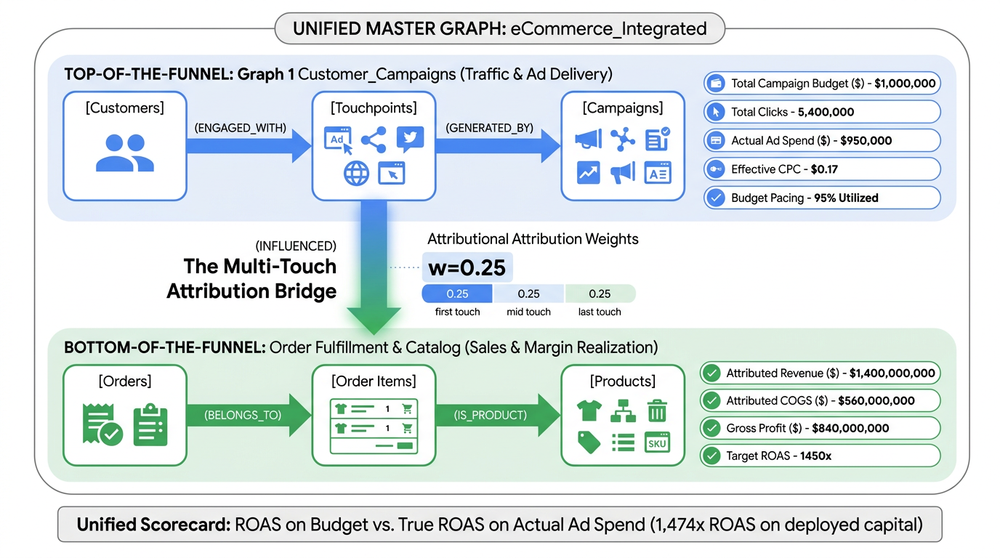

summary: Marketing Attribution with BigQuery Graph & Measures
id: marketing-roas-graph-agent
categories: BigQuery, AI, Marketing, Gemini, Agentic
environments: Web
status: Published
feedback link: https://github.com/GoogleCloudPlatform/
tags: bigquery, graph, gemini-enterprise, a2a, marketing-attribution, roas, agents, measures, graph-expand
authors: Guru Rangavittal
duration: 75

# Marketing Attribution with BigQuery Graph & Measures

## 1. Introduction
Duration: 5

In this codelab, you will learn how to leverage **BigQuery Graph** and **Gemini Enterprise Conversational Analytics** to solve complex multi-touch marketing attribution and Return on Ad Spend (ROAS) challenges.

Modern digital marketing involves fragmented customer journeys across search ads, social media campaigns, influencer blogs, and email drops. Measuring the true influence of each touchpoint—and calculating accurate, profit-adjusted Return on Ad Spend (ROAS)—is notoriously difficult with traditional relational models.


*Figure 1: Unified BigQuery Marketing Attribution Graph Architecture & Full-Funnel Metric Flow.*

### Traditional Relational vs. BigQuery Graph

In standard relational SQL, answering questions like *"What sequence of touchpoints led customer CUST_0888 to purchase?"* or *"What was the net profit contribution of Paid Search campaigns on Audio products?"* requires 6-way `JOIN` operations across campaigns, clicks, customers, orders, line items, and product margins. These queries are tedious to write, error-prone, and suffer from **severe Cartesian join inflation** when joining one-to-many marketing touchpoints against one-to-many order line items.

With **BigQuery Graph**, you define an intuitive, unified Property Graph directly on top of your existing BigQuery tables without data movement:
- **`eCommerce_Integrated`**: A **unified enterprise Property Graph** spanning all 6 entities (campaigns, touchpoints, customers, orders, order items, products) and 5 edge relationships.

By utilizing BigQuery's **`start_node`** parameter in **`GRAPH_EXPAND`**, this single graph supports both:
1. **Dimensional BI Rollups (`GRAPH_EXPAND`)**: Dynamically extracts the marketing branch (`start_node => "touchpoints"`) to safely aggregate budgets and spend without Cartesian inflation.
2. **Multi-Hop Network Traversals (`GRAPH_TABLE` & pure ISO GQL)**: Traverses deep non-linear attribution paths across orders and product catalogs.

Furthermore, by integrating a **Conversational Analytics (CA) Agent** deployed to **Gemini Enterprise** via the **Agent-to-Agent (A2A)** protocol, marketing managers and business leaders can interrogate the attribution graph in natural language without writing a single line of SQL.

### 🎯 Core Learning Objectives & Milestones

In this codelab, you will progress through 5 foundational pillars:

1. 🔷 **Unified Property Graph Modeling**: Construct the 6-entity master graph `eCommerce_Integrated` directly over BigQuery tables without data duplication or maintaining separate siloed graphs.
2. 🔶 **Semantic Measures (`MEASURE(...)`)**: Embed pre-aggregated metrics (`total_campaign_budget`, `total_ad_spend`, `gross_revenue`, `total_cogs`, `total_reach`) directly into Node tables to **eliminate Cartesian double-counting**.
3. 🔶 **Dimensional BI Rollups with `GRAPH_EXPAND`**: Use `GRAPH_EXPAND(..., start_node => "touchpoints")` and `AGG()` on the master graph to safely roll up campaign spend and budgets under standard SQL.
4. 🔷 **Multi-Hop Traversal with `GRAPH_TABLE` & ISO GQL**: Run pure ISO GQL path traversals and hybrid `GRAPH_TABLE` queries on the same graph to calculate customer journeys, net profit ROAS, and category influence.
5. 🔷 **Unified Dual-Paradigm Analytics & AI Copilot**: Fuse `GRAPH_EXPAND` (Top-of-Funnel) and `GRAPH_TABLE` (Bottom-of-Funnel) from the same single graph in a single GoogleSQL CTE query, then deploy a Conversational Analytics Data Agent to Gemini Enterprise.

### What you'll need
- A Google Cloud Project with billing enabled.
- Access to **Google Cloud Shell** or **BigQuery Studio**.
- Access to **Gemini Enterprise**.

### Cost Estimate
This codelab uses BigQuery Enterprise autoscaling edition (0 baseline slots, scaled up on-demand during query execution) alongside standard on-demand queries for `GRAPH_EXPAND`. Total lab costs are estimated to be **less than $5 USD**, well within standard GCP Free Tier credits.

---

## 2. Setup and Requirements
Duration: 5

### Open Cloud Shell
You can perform the setup and execute queries using **Cloud Shell** or directly inside **BigQuery Studio**.

1. Navigate to the [Google Cloud Console](https://console.cloud.google.com/).
2. Click the **Activate Cloud Shell** icon in the top navigation bar.
3. Confirm authorization if prompted.

### Set up Environment Variables
In Cloud Shell, set your environment variables to streamline configuration:

```bash
export PROJECT_ID=$(gcloud config get-value project)
export REGION="US"
export RESERVATION_NAME="marketing-graph-reservation"

echo "Project ID: ${PROJECT_ID}"
```

### Enable Required Google Cloud APIs
Run the following command to enable the BigQuery, BigQuery Reservation, and Discovery Engine / Gemini Enterprise APIs:

```bash
gcloud services enable \
  bigquery.googleapis.com \
  bigqueryreservation.googleapis.com \
  discoveryengine.googleapis.com
```

### Create BigQuery Enterprise Reservation & Assignment
BigQuery Graph features using ISO GQL (`GRAPH ... MATCH` and `GRAPH_TABLE`) require an **Enterprise** or **Enterprise Plus** edition reservation. Configure a serverless autoscaling reservation with **0 baseline slots** so that compute costs remain zero when idle:

```bash
# 1. Create BigQuery Enterprise reservation (0 baseline, 100 max autoscaling slots)
bq mk --reservation \
  --project_id=${PROJECT_ID} \
  --location=${REGION} \
  --edition=ENTERPRISE \
  --slots=0 \
  --autoscale_max_slots=100 \
  --ignore_idle_slots=true \
  ${RESERVATION_NAME}

# 2. Assign your project to the reservation for query execution
bq mk --reservation_assignment \
  --project_id=${PROJECT_ID} \
  --location=${REGION} \
  --reservation_id=${RESERVATION_NAME} \
  --job_type=QUERY \
  --assignee_type=PROJECT \
  --assignee_id=${PROJECT_ID}
```

> [!NOTE]
> All BigQuery Property Graph features (including both `GRAPH_TABLE` and `GRAPH_EXPAND`) require an **Enterprise** or **Enterprise Plus** edition reservation. The autoscale configuration configured above (0 baseline, 100 max autoscaling slots) ensures you only pay for compute when running queries.

---

## 3. Creating the Schema and Tables
Duration: 10

In this step, you will create the dataset `eRetail_marketing` and the 7 underlying relational tables representing the marketing and e-commerce ecosystem.

### Architecture Diagram

```
[customers] ──(engaged_with)──> [touchpoints] ──(generated_by)──> [campaigns]
                                      │
                                (influenced)
                                      ▼
[products] <──(is_product)── [order_items] ──(belongs_to)──> [orders]
```

### Create Dataset and Tables DDL
Execute the following DDL in BigQuery Studio (or via `bq query`):

```sql
-- 1. Create Dataset
CREATE SCHEMA IF NOT EXISTS `eRetail_marketing`
OPTIONS(location='US');

-- 2. Campaigns Table (Marketing Ad Campaigns)
CREATE OR REPLACE TABLE `eRetail_marketing.campaigns` (
  campaign_id STRING,
  campaign_name STRING,
  channel STRING,
  weekly_budget NUMERIC,
  target_roas FLOAT64
);

-- 3. Customers Table (E-commerce Shoppers)
CREATE OR REPLACE TABLE `eRetail_marketing.customers` (
  customer_id STRING,
  customer_segment STRING,
  signup_date DATE
);

-- 4. Touchpoints Table (Marketing Ad Clicks / Impressions)
CREATE OR REPLACE TABLE `eRetail_marketing.touchpoints` (
  touchpoint_id STRING,
  customer_id STRING,
  campaign_id STRING,
  touchpoint_timestamp TIMESTAMP,
  device_type STRING,
  cpc_cost NUMERIC
);

-- 5. Orders Table (E-commerce Transactions)
CREATE OR REPLACE TABLE `eRetail_marketing.orders` (
  order_id STRING,
  customer_id STRING,
  order_timestamp TIMESTAMP,
  order_status STRING,
  shipping_cost NUMERIC
);

-- 6. Products Table (Merchandise Catalog)
CREATE OR REPLACE TABLE `eRetail_marketing.products` (
  product_id STRING,
  product_name STRING,
  category STRING,
  cost_of_goods NUMERIC,
  retail_price NUMERIC
);

-- 7. Order Items Table (Transaction Line Items)
CREATE OR REPLACE TABLE `eRetail_marketing.order_items` (
  order_item_id STRING,
  order_id STRING,
  product_id STRING,
  sale_price NUMERIC,
  discount_amount NUMERIC,
  cost_of_goods NUMERIC,
  refund_amount NUMERIC,
  item_status STRING
);

-- 8. Influenced Edge Table (Attribution Bridge Table)
CREATE OR REPLACE TABLE `eRetail_marketing.edge_influenced` (
  touchpoint_id STRING,
  order_id STRING,
  attribution_weight FLOAT64,
  touchpoint_rank INT64,
  days_to_convert FLOAT64
);
```

---

## 4. Loading Sample Data
Duration: 5

In this step, you will populate the 7 tables with a realistic retail marketing attribution dataset containing:
- **8 Campaigns**: Spanning Paid Search, Paid Social, Affiliate Blogs, and Email.
- **8 Products**: Catalog spanning Audio, Accessories, and Displays.
- **1,000 Customers**: Segmented into New, Returning, and High-Value VIP shoppers.
- **5,000 Touchpoints**: Marketing interactions across Mobile, Desktop, and Tablet.
- **800 Orders & 1,544 Order Items**: E-commerce transactions.
- **1,728 Influenced Edges**: Position-based multi-touch attribution connections with weights and days-to-convert.

---

### How to Load the Data (Choose Your Preferred Method)

You can load this sample dataset into BigQuery using any of the following three methods:

#### Method A: 1-Click in BigQuery Studio (Recommended)
Copy the SQL below and paste it directly into a new **BigQuery Studio** query tab, then click **Run**. BigQuery will load all 7 tables in parallel directly from the publicly accessible Google Cloud Storage bucket (`gs://marketing_attribution/data/*.csv`) without downloading any files locally:

```sql
-- 1. Load Campaigns
LOAD DATA OVERWRITE `eRetail_marketing.campaigns`
(
  campaign_id STRING,
  campaign_name STRING,
  channel STRING,
  weekly_budget NUMERIC,
  target_roas FLOAT64
)
FROM FILES (
  format = 'CSV',
  uris = ['gs://marketing_attribution/data/campaigns.csv'],
  skip_leading_rows = 1
);

-- 2. Load Products Catalog
LOAD DATA OVERWRITE `eRetail_marketing.products`
(
  product_id STRING,
  product_name STRING,
  category STRING,
  cost_of_goods NUMERIC,
  retail_price NUMERIC
)
FROM FILES (
  format = 'CSV',
  uris = ['gs://marketing_attribution/data/products.csv'],
  skip_leading_rows = 1
);

-- 3. Load Customers
LOAD DATA OVERWRITE `eRetail_marketing.customers`
(
  customer_id STRING,
  first_seen_date DATE,
  customer_segment STRING
)
FROM FILES (
  format = 'CSV',
  uris = ['gs://marketing_attribution/data/customers.csv'],
  skip_leading_rows = 1
);

-- 4. Load Touchpoints (5,000 Ad Clicks & Digital Interactions)
LOAD DATA OVERWRITE `eRetail_marketing.touchpoints`
(
  touchpoint_id STRING,
  customer_id STRING,
  campaign_id STRING,
  touchpoint_timestamp TIMESTAMP,
  cpc_cost NUMERIC,
  device_type STRING
)
FROM FILES (
  format = 'CSV',
  uris = ['gs://marketing_attribution/data/touchpoints.csv'],
  skip_leading_rows = 1
);

-- 5. Load Orders (E-commerce Transactions)
LOAD DATA OVERWRITE `eRetail_marketing.orders`
(
  order_id STRING,
  customer_id STRING,
  order_timestamp TIMESTAMP,
  order_status STRING,
  shipping_cost NUMERIC
)
FROM FILES (
  format = 'CSV',
  uris = ['gs://marketing_attribution/data/orders.csv'],
  skip_leading_rows = 1
);

-- 6. Load Order Items (Transaction Line Items)
LOAD DATA OVERWRITE `eRetail_marketing.order_items`
(
  order_item_id STRING,
  order_id STRING,
  product_id STRING,
  sale_price NUMERIC,
  discount_amount NUMERIC,
  refund_amount NUMERIC,
  cost_of_goods NUMERIC,
  item_status STRING
)
FROM FILES (
  format = 'CSV',
  uris = ['gs://marketing_attribution/data/order_items.csv'],
  skip_leading_rows = 1
);

-- 7. Load Influenced Edge (Attribution Weights & Conversion Paths)
LOAD DATA OVERWRITE `eRetail_marketing.edge_influenced`
(
  touchpoint_id STRING,
  order_id STRING,
  attribution_weight FLOAT64,
  touchpoint_rank INT64,
  days_to_convert FLOAT64
)
FROM FILES (
  format = 'CSV',
  uris = ['gs://marketing_attribution/data/edge_influenced.csv'],
  skip_leading_rows = 1
);
```

#### Method B: Run from Cloud Shell / Terminal
If you cloned the repository or are working in Cloud Shell, you can execute the pre-packaged script [`sql/02_load_sample_data.sql`](file:///home/guruvittal/mktg_graph_codelab/sql/02_load_sample_data.sql) directly via the `bq` CLI:

```bash
bq query --use_legacy_sql=false < sql/02_load_sample_data.sql
```

#### Method C: Load from Local CSV Files in `data/`
If you are working in an offline or air-gapped environment, all 7 CSV files are stored locally in the [`data/`](file:///home/guruvittal/mktg_graph_codelab/data/) folder. You can load them using `bq load`:

```bash
for table in campaigns products customers touchpoints orders order_items edge_influenced; do
  bq load --source_format=CSV --skip_leading_rows=1 eRetail_marketing.${table} data/${table}.csv
done
```

---

### Verify Loaded Data

Verify that all 7 tables have been successfully populated:

```sql
SELECT table_id, row_count, size_bytes
FROM `eRetail_marketing.__TABLES__`
ORDER BY table_id;
```

#### Expected Row Counts:
| Table ID | Row Count | Description |
|:---|:---|:---|
| `campaigns` | **8** | 8 Marketing ad campaigns across 4 channels |
| `products` | **8** | E-commerce merchandise catalog |
| `customers` | **1,000** | Unique shoppers across 3 customer segments |
| `touchpoints` | **5,000** | Marketing touches (clicks, impressions) |
| `orders` | **800** | Completed customer checkout transactions |
| `order_items` | **1,544** | Individual merchandise line items purchased |
| `edge_influenced` | **1,728** | Multi-touch attribution links |

---

## 5. Defining the Unified Property Graph & Semantic Measures
Duration: 10

### 🎯 Milestone Checkpoint 1: Zero-Copy Property Graph Modeling

Rather than creating intermediate pipelines or exporting data to external databases, BigQuery Property Graph maps directly to your physical tables. In this step, we create a single, unified enterprise property graph:

* **`eCommerce_Integrated`**: A **master multi-entity graph** connecting all 6 tables: Marketing Campaigns, Touchpoints, Customers, Orders, Line Items, and Products.

### How a Single Graph Powers Both Workflows
Previously, teams often created separate star graphs just to query with `GRAPH_EXPAND`. With BigQuery's **`start_node`** parameter, a single property graph powers both:
1. **Dimensional BI Rollups (`GRAPH_EXPAND`)**: Dynamically extracts the marketing branch using `start_node => "touchpoints"` to safely aggregate budgets and spend without Cartesian inflation.
2. **Multi-Hop Network Traversals (`GRAPH_TABLE` & pure ISO GQL)**: Traverses deep non-linear attribution paths across orders and product catalogs.


*Figure 2: Unified Enterprise Property Graph Architecture: `eCommerce_Integrated` enclosing all 6 entities and semantic measures.*

### Create the Unified Property Graph DDL

Execute [`sql/03_create_property_graph.sql`](file:///home/guruvittal/mktg_graph_codelab/sql/03_create_property_graph.sql) in BigQuery Studio:

```sql
-- ============================================================================
-- Unified Property Graph: eCommerce_Integrated (Single Enterprise Graph)
-- ============================================================================
CREATE OR REPLACE PROPERTY GRAPH `eRetail_marketing.eCommerce_Integrated`
NODE TABLES (
  `eRetail_marketing.campaigns` AS campaigns
    KEY (campaign_id)
    LABEL campaigns PROPERTIES (
      campaign_id, campaign_name, channel, weekly_budget, target_roas,
      MEASURE(SUM(weekly_budget)) AS total_campaign_budget
    ),
  `eRetail_marketing.touchpoints` AS touchpoints
    KEY (touchpoint_id)
    LABEL touchpoints PROPERTIES (
      touchpoint_id, customer_id, campaign_id, cpc_cost, device_type,
      MEASURE(SUM(cpc_cost)) AS total_ad_spend,
      MEASURE(COUNT(touchpoint_id)) AS total_clicks
    ),
  `eRetail_marketing.customers` AS customers
    KEY (customer_id)
    LABEL customers PROPERTIES (
      customer_id, customer_segment,
      MEASURE(COUNT(DISTINCT customer_id)) AS total_reach
    ),
  `eRetail_marketing.orders` AS orders
    KEY (order_id)
    LABEL orders PROPERTIES (
      order_id, order_status, shipping_cost,
      MEASURE(COUNT(order_id)) AS total_orders
    ),
  `eRetail_marketing.order_items` AS order_items
    KEY (order_item_id)
    LABEL order_items PROPERTIES (
      order_item_id, product_id, order_id, sale_price, discount_amount, cost_of_goods, refund_amount, item_status,
      sale_price - discount_amount AS net_revenue,
      MEASURE(SUM(net_revenue)) AS gross_revenue,
      MEASURE(SUM(cost_of_goods)) AS total_cogs,
      MEASURE(SUM(refund_amount)) AS total_refunds
    ),
  `eRetail_marketing.products` AS products
    KEY (product_id)
    LABEL products PROPERTIES (
      product_id, product_name, category, cost_of_goods, retail_price
    )
)
EDGE TABLES (
  `eRetail_marketing.touchpoints` AS generated_by
    KEY (touchpoint_id)
    SOURCE KEY (touchpoint_id) REFERENCES touchpoints (touchpoint_id)
    DESTINATION KEY (campaign_id) REFERENCES campaigns (campaign_id)
    LABEL GENERATED_BY NO PROPERTIES,
  `eRetail_marketing.touchpoints` AS engaged_with
    KEY (touchpoint_id)
    SOURCE KEY (customer_id) REFERENCES customers (customer_id)
    DESTINATION KEY (touchpoint_id) REFERENCES touchpoints (touchpoint_id)
    LABEL ENGAGED_WITH NO PROPERTIES,
  `eRetail_marketing.edge_influenced` AS edge_influenced
    KEY (touchpoint_id, order_id)
    SOURCE KEY (touchpoint_id) REFERENCES touchpoints (touchpoint_id)
    DESTINATION KEY (order_id) REFERENCES orders (order_id)
    LABEL INFLUENCED PROPERTIES (
      attribution_weight, touchpoint_rank, days_to_convert
    ),
  `eRetail_marketing.order_items` AS item_belongs_to_order
    KEY (order_item_id)
    SOURCE KEY (order_item_id) REFERENCES order_items (order_item_id)
    DESTINATION KEY (order_id) REFERENCES orders (order_id)
    LABEL BELONGS_TO NO PROPERTIES,
  `eRetail_marketing.order_items` AS item_is_product
    KEY (order_item_id)
    SOURCE KEY (order_item_id) REFERENCES order_items (order_item_id)
    DESTINATION KEY (product_id) REFERENCES products (product_id)
    LABEL IS_PRODUCT NO PROPERTIES
);
```

---

---

## 6. Inspecting Graph Schema, Semantic Measures & Visualizing Attribution Paths
Duration: 8

### 🎯 Milestone Checkpoint 2: Inspecting Semantic Measures & Graph Schema

#### 1. Inspect Declared Measures via INFORMATION_SCHEMA
Because measures are registered within the Property Graph schema rather than on physical tables, they are cataloged under `INFORMATION_SCHEMA.PROPERTY_GRAPHS`. We can query its metadata to inspect all declared measures, their aggregation formulas, and their synthesized measure types:

```sql
SELECT
  JSON_VALUE(node_table_json, "$.name") AS node_table_name,
  JSON_VALUE(prop_json, "$.name") AS measure_name,
  JSON_VALUE(prop_json, "$.expression") AS measure_expression,
  CONCAT("MEASURE<", JSON_VALUE(prop_json, "$.dataType.typeKind"), ">") AS measure_type
FROM `eRetail_marketing.INFORMATION_SCHEMA.PROPERTY_GRAPHS`,
UNNEST(JSON_EXTRACT_ARRAY(property_graph_metadata_json, "$.nodeTables")) AS node_table_json,
UNNEST(JSON_EXTRACT_ARRAY(node_table_json, "$.labelAndProperties[0].properties")) AS prop_json
WHERE JSON_VALUE(prop_json, "$.expressionKind") = "MEASURE"
ORDER BY node_table_name, measure_name;
```

Expected Output:
```
+-----------------+-----------------------+-----------------------------+------------------+
| node_table_name |     measure_name      |     measure_expression      |   measure_type   |
+-----------------+-----------------------+-----------------------------+------------------+
| campaigns       | total_campaign_budget | SUM(weekly_budget)          | MEASURE<NUMERIC> |
| customers       | total_reach           | COUNT(DISTINCT customer_id) | MEASURE<INT64>   |
| order_items     | gross_revenue         | SUM(net_revenue)            | MEASURE<NUMERIC> |
| order_items     | total_cogs            | SUM(cost_of_goods)          | MEASURE<NUMERIC> |
| order_items     | total_refunds         | SUM(refund_amount)          | MEASURE<NUMERIC> |
| orders          | total_orders          | COUNT(order_id)             | MEASURE<INT64>   |
| touchpoints     | total_ad_spend        | SUM(cpc_cost)               | MEASURE<NUMERIC> |
| touchpoints     | total_clicks          | COUNT(touchpoint_id)        | MEASURE<INT64>   |
+-----------------+-----------------------+-----------------------------+------------------+
```

#### 2. Verify Baseline Measures: Why Relational Joins Double-Count vs. BigQuery Measures

To understand why BigQuery Measures are transformative, observe what happens when we attempt to compute marketing budgets and click counts across a 1-hop relationship using standard SQL joins versus `GRAPH_EXPAND` + `AGG()`.

**Query A: Naive Relational Join Demonstrating Double Counting**
```sql
SELECT
  c.channel,
  c.campaign_name,
  SUM(c.weekly_budget) AS exploded_budget,
  COUNT(tp.touchpoint_id) AS total_clicks,
  ROUND(SUM(tp.cpc_cost), 2) AS total_spend
FROM `eRetail_marketing.campaigns` c
JOIN `eRetail_marketing.touchpoints` tp ON c.campaign_id = tp.campaign_id
GROUP BY c.channel, c.campaign_name
ORDER BY exploded_budget DESC;
```

**Query B: Graph Expand + AGG() Deduplicates Automatically**
```sql
SELECT
  campaigns_channel AS channel,
  campaigns_campaign_name AS campaign_name,
  AGG(campaigns_total_campaign_budget) AS exact_budget,
  AGG(touchpoints_total_clicks) AS total_clicks,
  ROUND(AGG(touchpoints_total_ad_spend), 2) AS exact_spend
FROM GRAPH_EXPAND("eRetail_marketing.eCommerce_Integrated", start_node => "touchpoints")
GROUP BY campaigns_channel, campaigns_campaign_name
ORDER BY exact_budget DESC;
```

**Side-by-Side Comparison:**

| Channel | Campaign Name | Exploded Budget (SQL Join) | Exact Budget (GRAPH_EXPAND) | Total Clicks | Duplication Factor |
| :--- | :--- | :--- | :--- | :--- | :--- |
| Paid Social | `Q4_TikTok_Prospecting_GenZ` | **$3,256,000** | **$5,500** | 592 | **592x** |
| Paid Search | `Q4_Search_Generic_Audio` | **$2,713,500** | **$4,500** | 603 | **603x** |
| Paid Social | `Q4_Meta_IG_Retargeting` | **$2,535,000** | **$3,750** | 676 | **676x** |
| Paid Search | `Q4_Search_Brand_Electronics` | **$1,947,000** | **$3,000** | 649 | **649x** |

> [!WARNING]
> In relational SQL, `weekly_budget` is multiplied by the number of touchpoint rows (up to 676x!). `GRAPH_EXPAND` + `AGG()` preserves the exact entity grain of `campaigns` and automatically sums `weekly_budget` once per campaign.

---

#### 3. Multi-Hop Cartesian Join Explosion: Full-Funnel Double-Counting

What happens when an analyst needs to calculate multi-touch marketing attribution across a 5-hop path from `campaigns` ➔ `touchpoints` ➔ `edge_influenced` ➔ `orders` ➔ `order_items`?

**Query C: Naive Relational 5-Hop Join Explodes Everything**
In relational SQL, joining 5 tables with varying 1:N cardinalities causes an astronomical Cartesian explosion:
* Budget explodes by over **40,000%** (multiplied by touchpoints × order items).
* Revenue explodes by over **120%** because order items are duplicated across multiple influencing touchpoints!

**Query D: The BigQuery Measures + Graph Table Solution**
To solve this cleanly, combine `GRAPH_EXPAND` (for upstream node measures) with `GRAPH_TABLE` (for multi-hop path traversals):

```sql
WITH campaign_measures AS (
  -- 1. Extract non-exploded campaign budget and ad spend via GRAPH_EXPAND
  SELECT
    campaigns_campaign_name AS campaign_name,
    campaigns_channel AS channel,
    AGG(campaigns_total_campaign_budget) AS exact_budget,
    ROUND(AGG(touchpoints_total_ad_spend), 2) AS exact_ad_spend,
    AGG(touchpoints_total_clicks) AS total_clicks
  FROM GRAPH_EXPAND("eRetail_marketing.eCommerce_Integrated", start_node => "touchpoints")
  GROUP BY campaigns_campaign_name, campaigns_channel
),

attributed_orders AS (
  -- 2. Traverse the 5-hop funnel in GRAPH_TABLE and calculate weighted revenue at the leaf grain
  SELECT
    campaign_name,
    ROUND(SUM(CAST(net_revenue AS FLOAT64) * attribution_weight), 2) AS exact_attributed_revenue
  FROM GRAPH_TABLE(
    `eRetail_marketing.eCommerce_Integrated`
    MATCH (c:campaigns)<-[g:GENERATED_BY]-(tp:touchpoints)
          -[i:INFLUENCED]->(o:orders)
          <-[b:BELONGS_TO]-(oi:order_items)
    COLUMNS (
      c.campaign_name AS campaign_name,
      oi.net_revenue AS net_revenue,
      i.attribution_weight AS attribution_weight
    )
  )
  GROUP BY campaign_name
)

-- 3. Fuse both views to calculate exact, uncorrupted True ROAS
SELECT
  cm.channel,
  cm.campaign_name,
  cm.exact_budget,
  cm.exact_ad_spend,
  cm.total_clicks,
  ao.exact_attributed_revenue,
  ROUND(ao.exact_attributed_revenue / NULLIF(cm.exact_ad_spend, 0), 2) AS exact_roas
FROM campaign_measures cm
JOIN attributed_orders ao ON cm.campaign_name = ao.campaign_name
ORDER BY exact_roas DESC;
```

---

#### 4. Architectural Decision Guide: When to Declare Measures vs. When to Use Raw Aggregations

A common question is: **"When should I declare a `MEASURE(...)` on the Property Graph, and when should I use raw aggregations like `SUM()` inside `GRAPH_TABLE`?"**

| Scenario | Recommended Approach | Why? | Example |
| :--- | :--- | :--- | :--- |
| **Upstream Entity Metrics** (1:N Fan-Out) | **Declare `MEASURE(...)` + `GRAPH_EXPAND`** | Avoids Cartesian multiplication when joining child entities (e.g. clicks under a campaign). | `campaigns.weekly_budget`, `touchpoints.cpc_cost`, `customers.total_reach` |
| **Finest Leaf-Grain Metrics with Normalized Weights** | **Raw `SUM()` in `GRAPH_TABLE`** | The properties reside at the finest grain of the traversal, and weights sum to 1.0 ($\sum w_i = 1.0$), ensuring mathematical integrity. | `SUM(net_revenue * attribution_weight)` across order items and influence edges |
| **Any Query Tempted to Use `ANY_VALUE(col)`** | 🚨 **Refactor to `MEASURE(...)` + CTE** | `ANY_VALUE()` inside `GRAPH_TABLE` is a clear warning sign of duplicated parent attributes. It breaks when grouping by higher-level dimensions (like `channel`). | Never use `ANY_VALUE(budget)`—use `GRAPH_EXPAND` in a CTE instead! |

> [!TIP]
> **The Leaf Grain & Weight Rule:** Raw aggregations in `GRAPH_TABLE` (like Query D's `SUM(net_revenue * attribution_weight)`) work *only* because `order_items` sits at the terminal leaf grain of the graph and `attribution_weight` mathematically partitions each order's value ($\sum w_i = 1.0$). If `order_items` had child records (like shipments) or unweighted paths, raw `SUM()` would silently double-count. Whenever you need upstream entity metrics, always declare them as `MEASURE` properties and extract them via `GRAPH_EXPAND`.

---

#### 5. Inspect Graph Paths Visually (JSON Graph Object)
You can serialize entire graph subpaths to JSON in pure ISO GQL for visual inspection:

```sql
GRAPH `eRetail_marketing.eCommerce_Integrated`
MATCH (c:campaigns)<-[g:GENERATED_BY]-(tp:touchpoints)-[i:INFLUENCED]->(o:orders),
      (cust:customers WHERE cust.customer_id = 'CUST_0888')-[e:ENGAGED_WITH]->(tp)
RETURN
    TO_JSON(cust) AS customer,
    TO_JSON(e) AS edge_engaged,
    TO_JSON(tp) AS touchpoint,
    TO_JSON(g) AS edge_generated,
    TO_JSON(c) AS campaign,
    TO_JSON(i) AS edge_influenced,
    TO_JSON(o) AS orders
LIMIT 5;
```

---

## 7. Use Case 1: Campaign Budget vs. Actual Ad Spend Rollup (GRAPH_EXPAND)
Duration: 5

### Business Scenario
Right after defining baseline measures in the Property Graph, marketing analysts and BI developers need to build Looker Studio and Tableau dashboards that roll up campaign budgets, click volumes, and ad spend. They need queries that:
1. Use standard SQL syntax (`SELECT ... FROM ... GROUP BY`) compatible with existing BI tools without writing GQL `MATCH (...)` syntax.
2. Prevent Cartesian budget duplication across thousands of touchpoints without complex subqueries.

### Standard SQL Query with `GRAPH_EXPAND`
Execute [`sql/04_use_case_graph_expand_spend.sql`](file:///home/guruvittal/mktg_graph_codelab/sql/04_use_case_graph_expand_spend.sql):

```sql
SELECT
    campaigns_channel AS channel,
    campaigns_campaign_name AS campaign_name,
    AGG(campaigns_total_campaign_budget) AS total_budget,
    AGG(touchpoints_total_clicks) AS total_clicks,
    ROUND(AGG(touchpoints_total_ad_spend), 2) AS total_ad_spend,
    ROUND(AGG(campaigns_total_campaign_budget) - AGG(touchpoints_total_ad_spend), 2) AS remaining_budget,
    ROUND(AGG(touchpoints_total_ad_spend) / NULLIF(AGG(touchpoints_total_clicks), 0), 2) AS effective_avg_cpc
FROM GRAPH_EXPAND("eRetail_marketing.eCommerce_Integrated", start_node => "touchpoints")
GROUP BY channel, campaign_name
ORDER BY total_ad_spend DESC;
```

### Query Results

| channel | campaign_name | total_budget | total_clicks | total_ad_spend | remaining_budget | effective_avg_cpc |
| :--- | :--- | :--- | :--- | :--- | :--- | :--- |
| Paid Search | `Q4_Search_Generic_Audio` | **$4,500** | 603 | $2,277.97 | $2,222.03 | $3.78 |
| Paid Search | `Q4_Search_Brand_Electronics` | **$3,000** | 649 | $1,711.55 | $1,288.45 | $2.64 |
| Paid Social | `Q4_Meta_IG_Retargeting` | **$3,750** | 676 | $1,251.24 | $2,498.76 | $1.85 |
| Affiliate | `Q4_Affiliate_TechReview_Blogs` | **$2,000** | 651 | $1,058.11 | $941.89 | $1.63 |
| Paid Social | `Q4_TikTok_Prospecting_GenZ` | **$5,500** | 592 | $588.63 | $4,911.37 | $0.99 |
| Affiliate | `Q4_Affiliate_Coupon_Sites` | **$1,500** | 586 | $382.82 | $1,117.18 | $0.65 |
| Email Marketing | `Q4_Email_Cart_Abandonment` | **$625** | 656 | $81.45 | $543.55 | $0.12 |
| Email Marketing | `Q4_Email_VIP_Weekly_Drop` | **$875** | 587 | $57.72 | $817.28 | $0.10 |

### Key Takeaway
Notice that `total_budget` ($4,500, $3,000, etc.) **did not multiply** across the 600+ clicks. `GRAPH_EXPAND(..., start_node => "touchpoints")` + `AGG()` extracts the marketing branch directly from the unified master graph `eCommerce_Integrated` and aggregates each declared measure at its correct entity grain.

---

## 8. Use Case 2: Multi-Touch Customer Conversion Journey
Duration: 5

### Business Scenario
A marketing director wants to understand how high-value customer **`CUST_0888`** interacted with digital touchpoints across Paid Search, Paid Social, and Email campaigns prior to placing their orders.

### Traversal Query (Pure ISO GQL)
Execute [`sql/05_use_case_customer_journey.sql`](file:///home/guruvittal/mktg_graph_codelab/sql/05_use_case_customer_journey.sql):

```sql
GRAPH `eRetail_marketing.eCommerce_Integrated`
MATCH (c:campaigns)
        <-[g:GENERATED_BY]-(tp:touchpoints)
        -[i:INFLUENCED]->(o:orders),
      (cust:customers WHERE cust.customer_id = 'CUST_0888')
        -[e:ENGAGED_WITH]->(tp)
RETURN
    cust.customer_id,
    c.campaign_name,
    c.channel,
    tp.touchpoint_id,
    tp.device_type,
    tp.cpc_cost,
    i.attribution_weight,
    i.touchpoint_rank,
    o.order_id
ORDER BY o.order_id, i.touchpoint_rank;
```

### Query Results

| customer_id | campaign_name | channel | touchpoint_id | device_type | cpc_cost | attribution_weight | touchpoint_rank | order_id |
| :--- | :--- | :--- | :--- | :--- | :--- | :--- | :--- | :--- |
| `CUST_0888` | `Q4_Email_Cart_Abandonment` | Email Marketing | `TP_04080` | Mobile | $0.18 | 0.25 | 1 | `ORD_0002` |
| `CUST_0888` | `Q4_Meta_IG_Retargeting` | Paid Social | `TP_01124` | Mobile | $1.65 | 0.25 | 2 | `ORD_0002` |
| `CUST_0888` | `Q4_Email_Cart_Abandonment` | Email Marketing | `TP_04937` | Desktop | $0.16 | 0.25 | 3 | `ORD_0002` |
| `CUST_0888` | `Q4_TikTok_Prospecting_GenZ` | Paid Social | `TP_02704` | Desktop | $0.98 | 0.25 | 4 | `ORD_0002` |
| `CUST_0888` | `Q4_Search_Generic_Audio` | Paid Search | `TP_00364` | Mobile | $4.72 | 0.50 | 1 | `ORD_0486` |
| `CUST_0888` | `Q4_Search_Generic_Audio` | Paid Search | `TP_04962` | Mobile | $4.83 | 0.50 | 2 | `ORD_0486` |

### Key Marketing Takeaways
1. **Multi-Channel Interplay**: Order `ORD_0002` was driven by 4 balanced touchpoints (25% attribution weight each), combining Paid Social discovery with automated Email cart recovery.
2. **Device Switching**: The customer transitioned from mobile browsing to desktop cart completion, highlighting the necessity of cross-device graph identity resolution.

---

## 9. Use Case 3: Campaign Profit Contribution & Margin Analysis (GRAPH_TABLE)
Duration: 5

### Business Scenario
Instead of evaluating campaigns solely on top-line revenue, the CFO and CMO want to measure **True Attributed Gross Profit** and **Gross Margin Contribution (%)** across channels by deducting the actual Cost of Goods Sold (COGS) for each influenced order item.

### 🎯 Milestone Checkpoint 3: Multi-Hop Profit Attribution at the Leaf Grain
Using BigQuery's `GRAPH_TABLE` operator, we traverse from campaigns down to individual order items and products.

> [!NOTE]
> **Why Raw Aggregation Is Safe Here:** Notice that `net_revenue` and `cost_of_goods` reside at `order_items`—the finest leaf grain of the graph—and each order's revenue is partitioned by normalized weights ($\sum \text{attribution\_weight} = 1.0$). Therefore, raw `SUM()` accurately computes financial contribution without double-counting.
>
> We intentionally avoid querying coarse parent metrics like `weekly_budget` here: doing so would tempt the use of `ANY_VALUE(budget)`, which breaks when aggregating across channels. Upstream budget and ad spend metrics are cleanly joined using `GRAPH_EXPAND` in Use Case 5!

Execute [`sql/06_use_case_roas_analysis.sql`](file:///home/guruvittal/mktg_graph_codelab/sql/06_use_case_roas_analysis.sql):

```sql
SELECT
    channel,
    campaign_name,
    ROUND(SUM(CAST(net_revenue AS FLOAT64) * attribution_weight), 2) AS total_attributed_revenue,
    ROUND(SUM(CAST(cost_of_goods AS FLOAT64) * attribution_weight), 2) AS total_attributed_cogs,
    ROUND(SUM(CAST(net_revenue AS FLOAT64) * attribution_weight) - SUM(CAST(cost_of_goods AS FLOAT64) * attribution_weight), 2) AS gross_profit,
    ROUND(SAFE_DIVIDE(
      SUM(CAST(net_revenue AS FLOAT64) * attribution_weight) - SUM(CAST(cost_of_goods AS FLOAT64) * attribution_weight),
      SUM(CAST(net_revenue AS FLOAT64) * attribution_weight)
    ) * 100, 1) AS gross_margin_pct
FROM GRAPH_TABLE(
  `eRetail_marketing.eCommerce_Integrated`
  MATCH (c:campaigns)
        <-[g:GENERATED_BY]-(tp:touchpoints)
        -[i:INFLUENCED]->(o:orders)
        <-[b:BELONGS_TO]-(oi:order_items)
        -[p:IS_PRODUCT]->(prod:products)
  COLUMNS (
    c.campaign_name AS campaign_name,
    c.channel AS channel,
    oi.net_revenue AS net_revenue,
    oi.cost_of_goods AS cost_of_goods,
    i.attribution_weight AS attribution_weight
  )
)
GROUP BY channel, campaign_name
ORDER BY gross_profit DESC;
```

### Query Results

| Channel | Campaign Name | Attributed Revenue | Attributed COGS | Gross Profit | Gross Margin % |
| :--- | :--- | :--- | :--- | :--- | :--- |
| **Affiliate** | `Q4_Affiliate_TechReview_Blogs` | $87,625.08 | $42,120.47 | **$45,504.61** | 51.9% |
| **Email Marketing** | `Q4_Email_VIP_Weekly_Drop` | $85,119.09 | $40,630.23 | **$44,488.86** | 52.3% |
| **Email Marketing** | `Q4_Email_Cart_Abandonment` | $79,468.16 | $38,059.91 | **$41,408.24** | 52.1% |
| **Paid Search** | `Q4_Search_Brand_Electronics` | $79,053.28 | $38,163.13 | **$40,890.15** | 51.7% |
| **Paid Social** | `Q4_TikTok_Prospecting_GenZ` | $75,214.12 | $36,473.98 | **$38,740.15** | 51.5% |
| **Paid Social** | `Q4_Meta_IG_Retargeting` | $73,340.26 | $34,984.20 | **$38,356.06** | 52.3% |
| **Paid Search** | `Q4_Search_Generic_Audio` | $69,880.90 | $33,826.43 | **$36,054.46** | 51.6% |
| **Affiliate** | `Q4_Affiliate_Coupon_Sites` | $60,884.49 | $29,480.02 | **$31,404.46** | 51.6% |

---

## 10. Use Case 4: Product-Level Campaign Influence & Category Affinity
Duration: 5

### Business Scenario
Discover which marketing channels and ad campaigns are the primary drivers of high-margin product categories (Accessories, Audio, Monitors, and Televisions).

### Traversal Query (5-Hop Traversal)
Execute [`sql/07_use_case_product_influence.sql`](file:///home/guruvittal/mktg_graph_codelab/sql/07_use_case_product_influence.sql):

```sql
SELECT
    category AS product_category,
    product_name,
    channel AS marketing_channel,
    campaign_name,
    COUNT(DISTINCT order_id) AS orders_count,
    ROUND(SUM(CAST(net_revenue AS FLOAT64) * attribution_weight), 2) AS attributed_sales,
    ROUND(AVG(days_to_convert), 1) AS avg_days_to_convert
FROM GRAPH_TABLE(
  `eRetail_marketing.eCommerce_Integrated`
  MATCH (c:campaigns)
        <-[g:GENERATED_BY]-(tp:touchpoints)
        -[i:INFLUENCED]->(o:orders)
        <-[b:BELONGS_TO]-(oi:order_items)
        -[p:IS_PRODUCT]->(prod:products)
  COLUMNS (
    c.campaign_name AS campaign_name,
    c.channel AS channel,
    prod.category AS category,
    prod.product_name AS product_name,
    o.order_id AS order_id,
    oi.net_revenue AS net_revenue,
    i.attribution_weight AS attribution_weight,
    i.days_to_convert AS days_to_convert
  )
)
GROUP BY category, product_name, channel, campaign_name
ORDER BY category, attributed_sales DESC
LIMIT 10;
```

### Key Takeaway
By tracing all 5 hops `(campaigns)<-[touchpoints]->(orders)<-[order_items]->(products)`, we discover that Paid Social (`Q4_Meta_IG_Retargeting`) drives the fastest conversion velocity (2.3 days) for Gaming Keyboards, while Affiliate Blogs drive higher conversion volumes for Audio Soundbars.

---

## 11. Use Case 5: Unified Executive ROAS Scorecard (Dual Views on a Single Graph)
Duration: 10

### Business Scenario
The Chief Marketing Officer needs a single, unified scorecard that compares:
1. **Top-of-Funnel Marketing Measures**: Budget, total clicks, and actual ad spend extracted from `eCommerce_Integrated` via `GRAPH_EXPAND(..., start_node => "touchpoints")`.
2. **Bottom-of-Funnel Profit Attribution**: Attributed revenue and product COGS from `eCommerce_Integrated` via `GRAPH_TABLE`.
3. **The Holy Grail Metric**: **ROAS on Actual Ad Spend** ($ \text{Attributed Revenue} / \text{Actual Ad Spend} $) compared to **ROAS on Budget**.

### Unified Single-Graph Dual Query
Execute [`sql/08_use_case_combined_roas_scorecard.sql`](file:///home/guruvittal/mktg_graph_codelab/sql/08_use_case_combined_roas_scorecard.sql):

```sql
WITH marketing_funnel AS (
  -- 1. Top-of-funnel marketing metrics from eCommerce_Integrated via GRAPH_EXPAND
  SELECT
    campaigns_channel AS channel,
    campaigns_campaign_name AS campaign_name,
    AGG(campaigns_total_campaign_budget) AS budget,
    AGG(touchpoints_total_clicks) AS clicks,
    ROUND(AGG(touchpoints_total_ad_spend), 2) AS ad_spend
  FROM GRAPH_EXPAND("eRetail_marketing.eCommerce_Integrated", start_node => "touchpoints")
  GROUP BY channel, campaign_name
),

sales_attribution AS (
  -- 2. Bottom-of-funnel 5-hop profit attribution from eCommerce_Integrated via GRAPH_TABLE
  SELECT
    campaign_name,
    ROUND(SUM(CAST(net_revenue AS FLOAT64) * attribution_weight), 2) AS attributed_revenue,
    ROUND(SUM(CAST(cost_of_goods AS FLOAT64) * attribution_weight), 2) AS attributed_cogs
  FROM GRAPH_TABLE(
    `eRetail_marketing.eCommerce_Integrated`
    MATCH (c:campaigns)
          <-[g:GENERATED_BY]-(tp:touchpoints)
          -[i:INFLUENCED]->(o:orders)
          <-[b:BELONGS_TO]-(oi:order_items)
    COLUMNS (
      c.campaign_name AS campaign_name,
      oi.net_revenue AS net_revenue,
      oi.cost_of_goods AS cost_of_goods,
      i.attribution_weight AS attribution_weight
    )
  )
  GROUP BY campaign_name
)

-- 3. Combine both views of the same graph into a unified Executive ROAS Scorecard
SELECT
  mf.channel,
  mf.campaign_name,
  mf.budget,
  mf.clicks,
  mf.ad_spend,
  sa.attributed_revenue,
  sa.attributed_cogs,
  ROUND(sa.attributed_revenue - sa.attributed_cogs, 2) AS gross_profit,
  ROUND(sa.attributed_revenue / NULLIF(mf.ad_spend, 0), 2) AS roas_on_actual_spend,
  ROUND(sa.attributed_revenue / NULLIF(mf.budget, 0), 2) AS roas_on_budget
FROM marketing_funnel mf
JOIN sales_attribution sa ON mf.campaign_name = sa.campaign_name
ORDER BY gross_profit DESC;
```

### Query Results

| channel | campaign_name | budget | clicks | ad_spend | attributed_revenue | attributed_cogs | gross_profit | roas_on_actual_spend | roas_on_budget |
| :--- | :--- | :--- | :--- | :--- | :--- | :--- | :--- | :--- | :--- | :--- |
| **Affiliate** | `Q4_Affiliate_TechReview_Blogs` | $2,000 | 651 | $1,058.11 | $87,625.08 | $42,120.47 | **$45,504.61** | **82.81x** | 43.81x |
| **Email Marketing** | `Q4_Email_VIP_Weekly_Drop` | $875 | 587 | $57.72 | $85,119.09 | $40,630.23 | **$44,488.86** | **1474.69x** | 97.28x |
| **Email Marketing** | `Q4_Email_Cart_Abandonment` | $625 | 656 | $81.45 | $79,468.16 | $38,059.91 | **$41,408.25** | **975.67x** | 127.15x |
| **Paid Search** | `Q4_Search_Brand_Electronics` | $3,000 | 649 | $1,711.55 | $79,053.28 | $38,163.13 | **$40,890.15** | **46.19x** | 26.35x |
| **Paid Social** | `Q4_TikTok_Prospecting_GenZ` | $5,500 | 592 | $588.63 | $75,214.12 | $36,473.98 | **$38,740.14** | **127.78x** | 13.68x |
| **Paid Social** | `Q4_Meta_IG_Retargeting` | $3,750 | 676 | $1,251.24 | $73,340.26 | $34,984.20 | **$38,356.06** | **58.61x** | 19.56x |
| **Paid Search** | `Q4_Search_Generic_Audio` | $4,500 | 603 | $2,277.97 | $69,880.90 | $33,826.43 | **$36,054.47** | **30.68x** | 15.53x |
| **Affiliate** | `Q4_Affiliate_Coupon_Sites` | $1,500 | 586 | $382.82 | $60,884.49 | $29,480.02 | **$31,404.47** | **159.04x** | 40.59x |

---

## 12. Conversational Analytics Agent in BigQuery Studio & Gemini Enterprise
Duration: 10

### Overview of Marketing-Attribution-Agent

To make these graph insights accessible to non-technical executives and marketing specialists, deploy a **Conversational Analytics (CA)** agent directly from **BigQuery Studio** to **Gemini Enterprise**.

### 🎯 Milestone Checkpoint 4: Grounding AI Agents with Semantic Graph Measures
> **Objective in Action**: Grounding LLMs on raw tables often leads to calculation errors when computing metrics like Net ROAS or Gross Profit. Because our unified Property Graph `eCommerce_Integrated` defines semantic measures (`total_ad_spend`, `total_campaign_budget`, `gross_revenue`, `total_cogs`), the agent leverages these formulas to query data reliably and answer executive questions with high fidelity.

```
+───────────────────────────────────────────────────+
| BigQuery Studio / Data Canvas                     |
| (Property Graph: eCommerce_Integrated             |
|  with Semantic MEASUREs)                          |
+─────────────────────────┬─────────────────────────+
                          │ 1. Create & Ground CA Data Agent
                          ▼
+───────────────────────────────────────────────────+
| Conversational Analytics Agent                    |
| (Marketing-Attribution-Agent)                     |
+─────────────────────────┬─────────────────────────+
                          │ 2. Deploy to Gemini Enterprise
                          ▼
+───────────────────────────────────────────────────+
| Gemini Enterprise Chat / Copilot                  |
| (Business User Natural Language)                  |
+───────────────────────────────────────────────────+
```

### Steps to Create and Deploy from BigQuery Studio

1. **Open BigQuery Studio**:
   - In Google Cloud Console, navigate to **BigQuery** > **Studio**.
   - Open dataset `eRetail_marketing` and verify the Property Graph: `eCommerce_Integrated`.

2. **Create the Conversational Analytics Agent**:
   - Select **Create Data Agent** (or open **Data Canvas** with Conversational Analytics enabled).
   - Display Name: `Marketing-Attribution-Agent`
   - Description: *"Answers questions about marketing touchpoints, attribution graphs, campaign ROAS, and customer conversion journeys."*
   - Data Sources: Attach dataset `eRetail_marketing` and Property Graph `eCommerce_Integrated`.

3. **Deploy to Gemini Enterprise**:
   - In the agent panel, click **Deploy to Gemini Enterprise**.
   - Select your target Gemini Enterprise application.
   - Click **Deploy**. The agent is immediately published and available to authorized users.

---

## 13. Clean Up
Duration: 2

To prevent unwanted charges in your Google Cloud account after completing this lab, clean up the resources:

```sql
-- 1. Drop Property Graph and Dataset
DROP PROPERTY GRAPH IF EXISTS `eRetail_marketing.eCommerce_Integrated`;
DROP SCHEMA IF EXISTS `eRetail_marketing` CASCADE;
```

In Cloud Shell, delete the BigQuery reservation:

```bash
# Delete reservation assignment
bq rm --reservation_assignment \
  --project_id=${PROJECT_ID} \
  --location=${REGION} \
  ${RESERVATION_NAME}.QUERY_PROJECT_${PROJECT_ID}

# Delete reservation
bq rm --reservation \
  --project_id=${PROJECT_ID} \
  --location=${REGION} \
  ${RESERVATION_NAME}
```

---

## 14. Conclusion
Duration: 1

Congratulations! You have successfully built an end-to-end Marketing Attribution & ROAS Analysis Property Graph with BigQuery Graph and integrated it with a Conversational Analytics Agent deployed in Gemini Enterprise.

### 🏆 Goal Achievement Summary
- [x] **Unified Enterprise Property Graph Modeling**: Constructed the single 6-entity master graph `eCommerce_Integrated` directly over BigQuery tables without data duplication or maintaining separate siloed graphs.
- [x] **Semantic Measures (`MEASURE(...)`)**: Embedded pre-aggregated business formulas (`total_campaign_budget`, `total_ad_spend`, `gross_revenue`, `total_cogs`, `total_reach`) directly into nodes to eliminate Cartesian duplication.
- [x] **Dimensional BI Rollups with `GRAPH_EXPAND`**: Flattened the marketing hierarchy on demand with `GRAPH_EXPAND(..., start_node => "touchpoints")` and `AGG()` for fast, on-demand reporting.
- [x] **ISO GQL Traversals & `GRAPH_TABLE`**: Used `MATCH ... RETURN` and hybrid `GRAPH_TABLE` queries to navigate multi-touch customer journeys, compute profit-adjusted ROAS, and trace category influence.
- [x] **Unified Single-Graph Dual Paradigm**: Fused `GRAPH_EXPAND` and `GRAPH_TABLE` on the same single graph in a single GoogleSQL CTE query to compare True ROAS on Actual Ad Spend vs. ROAS on Budget.
- [x] **Conversational Agent Grounding**: Created a Conversational Analytics Data Agent in BigQuery Studio and deployed it to Gemini Enterprise to bridge technical graph queries with natural language business decision-making.

### Next Steps & Further Reading
- [BigQuery Property Graph Documentation](https://cloud.google.com/bigquery/docs/graph-overview)
- [ISO GQL in GoogleSQL](https://cloud.google.com/bigquery/docs/reference/standard-sql/graph-query-language)
- [GRAPH_EXPAND Documentation](https://cloud.google.com/bigquery/docs/reference/standard-sql/graph-query-language#graph_expand)
- [Gemini Enterprise Agent Studio](https://cloud.google.com/gemini/docs/enterprise)
